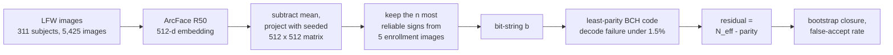
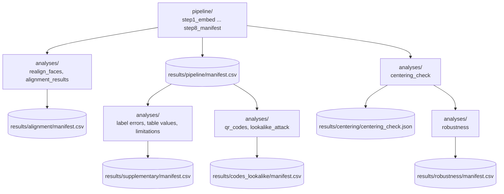

# Shorter, Not Longer?

Code and results for the paper **"Shorter, Not Longer? Residual Entropy of BCH Fuzzy Commitments over Deep Face Embeddings"** (ITI 2026, Springer LNNS).

A fuzzy commitment stores a face template as `C = b XOR codeword`, where `b` is a bit-string derived from a face embedding. Anyone who reads `C` learns at most as many bits about `b` as the code spends on parity. So the scheme only protects anything if the bit-string carries more entropy than the parity it pays. We measure both sides on LFW for one concrete extractor and sweep the bit-string length `n`. The surprise is that longer is not better: the residual stays positive only up to short lengths, and the selection rule in the paper lands on **n = 15** (BCH(15,7,5): +4.1 effective degrees of freedom, about 1 false accept in 114 impostor attempts).

This repository has everything needed to recompute every number in the paper from the raw LFW images.

## How the pipeline works



For every length `n`, the first 5 images of each subject are used for enrollment and the rest (3,870) as probes. The probe bit-strings give the decode failure, which picks the code. Impostor comparisons give the false-accept rate and `N_eff`, the effective number of independent bits. A subject-level bootstrap tells how often the residual stays positive ("closure").

The scripts run in this order and write their results under `results/`:



## Repository layout

```
fuzzycommit/     library: embeddings, bit selection, exact BCH parity, false accepts, N_eff, bootstrap
pipeline/        the main run, step1_embed.py ... step8_manifest.py
analyses/        extra analyses in the paper: landmark alignment, label errors, QR codes,
                 lookalike attack, centering check, and the robustness of the
                 single-draw results to other seeds and draws
checks/          two scripts that recompute results and compare them with checks/expected/,
                 and compare_manifests.py for comparing a rerun with the committed results
results/         the published results: one manifest.csv per part, plus the step outputs
```

## Setup

Python 3.14 with the exact package versions we used:

```
git clone https://github.com/Alternateacc-1/shorter-not-longer.git
cd shorter-not-longer
python -m venv .venv
.venv\Scripts\activate          # Windows
source .venv/bin/activate       # Linux / macOS
pip install -r requirements.txt
```

Every script records the git commit it ran from and refuses to run on uncommitted code, so work from a clone. If you downloaded a zip instead, run `git init`, `git add -A` and `git commit -m init` in the folder first. For quick experiments on modified code, set `DEV_RUN=1`; the outputs then go to `results/pipeline/dev/` and the published files are left alone.

## Data and models

Neither the images nor the models are included. You need:

- **LFW, deep-funneled.** We used the Kaggle copy [`jessicali9530/lfw-dataset`](https://www.kaggle.com/datasets/jessicali9530/lfw-dataset), version 4, folder `lfw-deepfunneled/lfw-deepfunneled` (13,233 images), with `pairs.csv` two folders above it. The official source is the [LFW project page](http://vis-www.cs.umass.edu/lfw/). Tell the scripts where it is with the `LFW_DIR` environment variable or a line `lfw_dir = <path>` in a file `paths.conf` at the repository root (the default is the kagglehub cache).
- **InsightFace `buffalo_l`** ([releases page](https://github.com/deepinsight/insightface/releases)). Put `w600k_r50.onnx` (ArcFace R50) and `det_10g.onnx` (SCRFD, used only for the alignment analysis) in `models/`.

Step 1 checks the inputs by SHA-256:

| file | sha256 |
|---|---|
| `w600k_r50.onnx` | `4c06341c33c2ca1f86781dab0e829f88ad5b64be9fba56e56bc9ebdefc619e43` |
| `det_10g.onnx` | `5838f7fe053675b1c7a08b633df49e7af5495cee0493c7dcf6697200b85b5b91` |
| LFW file list (all 13,233 relative paths) | `1896b2abb030124a0f8d8ef2f0283439c9a1357bddfee5a45142270bfb582d9c` |
| the 5,425 corpus images (paths + bytes) | `696d891d0151616e14b09764c5b7d1b619c78498644df72bfc071c8ee0f4ddd3` |
| the 311 subject names | `c587f59d1847cfe5371fa2d2e426d669ee3a99db34dfc3906063337c742521c2` |

LFW belongs to its maintainers and is used here under their terms. This repository contains no images and no embeddings, only numbers computed from them, plus the file names of the four probe images the paper discusses as possible label errors.

## Running everything

From the repository root, with the environment active:

| # | command | what it does | time* |
|---|---|---|---|
| 1 | `python -m pipeline.step1_embed` | checks the inputs, embeds the 5,425 images | 9 min |
| 2 | `python -m pipeline.step2_sweep` | the length sweep: Table 1, Table 2, Fig. 2 | 23 min |
| 3 | `python -m pipeline.step3_lfw_benchmark` | LFW 6,000-pair accuracy of the embedding path | 12 min |
| 4 | `python -m pipeline.step4_robustness` | other codes, seeds, held-out splits, targets | 4 min |
| 5 | `python -m pipeline.step5_bound_seeds` | distribution-free bound for every seed | seconds |
| 6 | `python -m pipeline.step6_alignment` | landmark alignment instead of the centre crop | 32 min |
| 7 | `python -m pipeline.step7_checks` | runs the two check scripts (219 and 290 checks) | 12 min |
| 8 | `python -m pipeline.step8_manifest` | writes `results/pipeline/manifest.csv` | seconds |

\*on a 12-thread laptop (Intel i5-12450H, Windows 11). Step 1 refuses to start while an embedding file exists, so to start over delete `results/pipeline/embeddings_cache.npz` first. Run step 7 before step 8, or the four check-script rows are missing from the manifest.

Then the analyses, in this order (about 75 minutes, most of it the face re-alignment and the robustness runs):

```
python -m analyses.realign_faces
python -m analyses.alignment_results              # -> results/alignment/manifest.csv

python -m analyses.label_errors
python -m analyses.label_errors_n20
python -m analyses.table_values
python -m analyses.limitations_numbers
python -m analyses.build_manifest_supplementary   # -> results/supplementary/manifest.csv

python -m analyses.qr_codes
python -m analyses.lookalike_attack
python -m analyses.build_manifest_codes           # -> results/codes_lookalike/manifest.csv

python -m analyses.centering_check                # -> results/centering/centering_check.json
python -m analyses.robustness                     # -> results/robustness/manifest.csv (about 45 min)
```

The last one repeats the results that rest on one random choice (the bootstrap seed, the
projection matrix, which five images are enrolled, the 800 outside images, the random arm,
the noise-only control and the lookalike split) with other seeds and draws. The paper's own
seed or draw always comes first, and the script stops if it does not reproduce.

## Finding a number

Every number in the paper is a row in one of the five `manifest.csv` files, or is computed from rows there. Each row has the quantity, its value and units, the script and function that produced it, the seeds and the commit. To find one, search for its name, for example `closure_pct n=15 subject` or `FAR_ratio_full_pair n=64`.

A few descriptive counts come straight from the embeddings and have no row: the median (5) and maximum (525) probes per subject, the 1,715 probes left after capping at 10 per subject, and the single probe of the worst-rejected subject. The 95% interval [9.1, 10.3]×10⁻⁴ at n = 24 is in `results/pipeline/step2_sweep.json`.

A full run overwrites the manifests in place. To see what changed:

```
python checks/compare_manifests.py
```

It compares every value with the committed one and ignores the commit column.

## Seeds

| what | seed |
|---|---|
| global | 42 |
| projection matrix (shared by all enrollees) | 43 |
| robustness projections | 43, 101, 202, 303, 404 |
| subject bootstrap, 1,000 replicates | 542 + n |
| sampled false accepts, 10⁶ trials | 342 + n |
| held-out splits, 400 each | 20260903 and 20261001 |
| lookalike split / its binomial null | 3042 / 3043 |
| centering check, 800 outside images | 7 |
| robustness: bootstrap / projection / enrollment / outside draws | see `analyses/robustness.py` |

## Running on another operating system

We ran the full pipeline on Windows 11 and on Linux. Every number in the paper came out the same. numpy and ONNX Runtime round the last bit of a few floats differently per platform, so two rows that are hashes of float arrays differ between systems (`projection matrix sha256` and `embedding npz sha256`). With the paper's projection seed every count, code, closure and false-accept figure matched; the robustness seeds agreed to three significant digits and the landmark-aligned run, which re-detects faces, to about two.

## Citation

If you use this code, please cite the paper (also in `CITATION.cff`):

> T. Mogare, S. Pakhale, S. Shinde, M. Vasaikar, R. Deshmukh. *Shorter, Not Longer? Residual Entropy of BCH Fuzzy Commitments over Deep Face Embeddings.* ITI 2026, Lecture Notes in Networks and Systems, Springer.

## License

MIT, see `LICENSE`. Parts of the code were written with LLM assistance, as stated in the paper.
